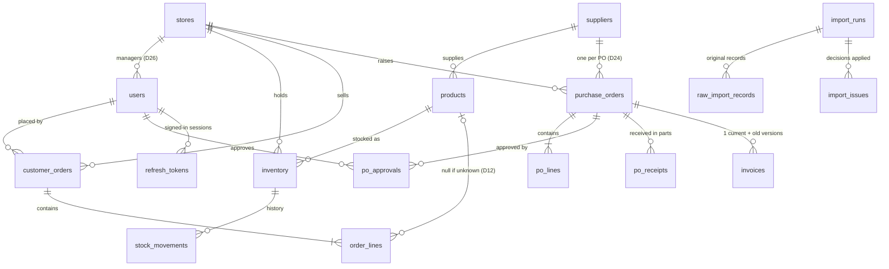

# Data model (core service)

Source of truth: [`V1__init.sql`](../backend/core-service/src/main/resources/db/migration/V1__init.sql) (Flyway).
The notification service keeps its own tables in its own migrations (DL-08, DL-09); nothing here is shared with it except events.

## Diagram

Also: `outbox_events` (events waiting to be published, DL-03), `app_settings` (remote config, DL-06), `audit_log` (who changed what).

## Tables in plain words

| Table | Holds | Key rules |
|---|---|---|
| `stores` | The 5 stores | `main_contact_user_id` is a label only (D26) |
| `users` | 12 users and their roles | A store manager has exactly one store; head office has none. Inactive users can't sign in (D20, D27). Passwords are hashed (D25). |
| `refresh_tokens` | Sign-in sessions | Stored hashed, so they can be revoked (logout, deactivation) |
| `suppliers` | SUP01–SUP25 | Created from the IDs; the admin fills in details (D24) |
| `products` | The catalogue | SKU is case-sensitive (D1). Price can be empty only for imported rows (D2). Archived = no new use (D3). |
| `inventory` | Stock per store and product | **Quantity can never go below 0** (D5, D29). `recount_needed` marks import corrections (D5). |
| `stock_movements` | Every stock change, with its reason | Order created or cancelled, PO receipt, adjustment, import correction |
| `customer_orders` | Customer orders | The ID is unique, so duplicates can't get in (D8). Customer is stored on the order (D16). Review status for the admin queue (D10). Idempotency key so a retry counts once. |
| `order_lines` | Items in an order | SKU kept as received; product link is empty if unknown (D12). Price is a snapshot (D15). Where a filled price came from (D11). One line per product (D14). New lines need qty > 0 (D10). |
| `purchase_orders` | Purchase orders | One supplier each (D24). Flags for historical rule breaks (D17–D19). `requires_reapproval` blocks receiving. Closing a stuck PO (D22). |
| `po_lines` | Items in a PO | Can't receive more than ordered |
| `po_approvals` | Finance decisions | Same person can't approve twice. At most one valid 1st and one valid 2nd approval, even under concurrent clicks. Order comes from time (D31). Manager or self approvals don't count (D18, D19). |
| `po_receipts` | Each delivery | Supports receiving in parts |
| `invoices` | Uploaded invoice files | PDF/PNG/JPEG, up to 20 MB, one current per PO, old versions kept |
| `outbox_events` | Events to publish | Written in the same transaction as the change (DL-03) |
| `app_settings` | Remote config | Draft expiry 14 days, stuck PO 30 days, stuck order 7 days, approval limit ₹50,000, first-login switch, maintenance banner |
| `audit_log` | Who changed what | Archive/unarchive, prices, reviews, PO closes, settings |
| `import_runs`, `raw_import_records`, `import_issues` | Import bookkeeping | The original record is kept exactly; every decision applied is logged and feeds the import report (D28) |

## Rules enforced by the database itself

These hold even if application code has a bug:
- stock ≥ 0, and the history's `quantity_after` ≥ 0
- one row per order ID, one line per product per order and per PO
- can't receive more than ordered
- same approver at most once per PO; at most one valid approval per step
- one current invoice per PO; invoice ≤ 20 MB and of an allowed type
- products created in the app must have a price
- a store manager must belong to a store
